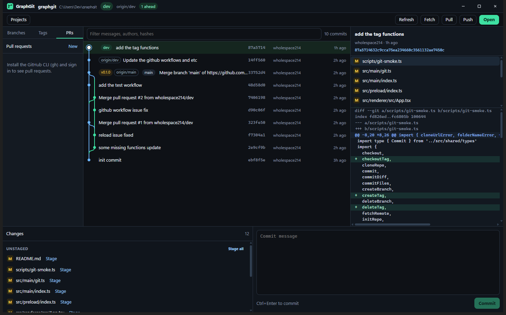

# GraphGit

GraphGit is a desktop Git client. It shows commit history as a graph, and it opens, clones, and updates repositories with the Git already installed on your machine.



## What you can do

- Keep a project list, with favorites and recent repositories
- Open a repository, clone one, or create a new one
- Read the commit graph, search history, and inspect a commit's files and diff
- Stage and unstage files, then commit
- Create, switch, and delete branches
- Fetch, pull, and push

GraphGit does not change your Git configuration. A commit uses the name and email already set in Git.

## Requirements

- [Git](https://git-scm.com/) available as `git` on your PATH
- Windows, macOS, or Linux

## Download

Installers are published on [GitHub Releases](https://github.com/wholespace214/graphgit/releases) when a version tag is pushed.

| System | File |
| --- | --- |
| Windows | `GraphGit-Setup-<version>.exe`, or `GraphGit-<version>-portable.exe` |
| macOS | `GraphGit-<version>-mac-<arch>.dmg` |
| Linux | `GraphGit-<version>-linux-x86_64.AppImage` or `GraphGit-<version>-linux-amd64.deb` |

These builds are not code-signed. Windows SmartScreen and macOS Gatekeeper can ask you to confirm the app before it opens.

## Develop

Node.js 22 or newer.

```bash
npm install
npm run dev
```

Set `GRAPHGIT_REPO` to a repository path to add that repository to the project list on startup.

```bash
npm run typecheck
npm run smoke
npm run dist
```

`npm run dist` writes installers for the current system into `release/`.

## Test before a tag

The Test workflow runs on every push to `main` or `pre`, and on pull requests. It typechecks the app, runs the smoke test, and builds the Windows, macOS, and Linux installers. It does not publish a release. Wait until that workflow is green before creating a tag.

## Make a release

After Test is green, check out `main` and push a version tag from that commit. A tag from any other branch is removed and is not published. A commit that is also on `pre` is still a stable release when it is on `main`.

```bash
git checkout main
git pull
git tag v0.1.0
git push origin v0.1.0
```

The tag must look like `vX.Y.Z`. The workflow sets the packaged version from the tag. Running the Release workflow by hand, without a tag, builds the installers and keeps them as workflow artifacts. It does not publish a release.

## Make a pre-release

Pre-releases come from the `pre` branch. Tag a commit that is on `pre` and not yet on `main`. GitHub marks it as a pre-release, and it does not replace the stable Latest download.

```bash
git checkout pre
git pull
git tag v0.1.0-beta.1
git push origin v0.1.0-beta.1
```

The next trial is `v0.1.0-beta.2`. When that build is ready to be the stable release, merge `pre` into `main` and tag `v0.1.0` from `main`.
